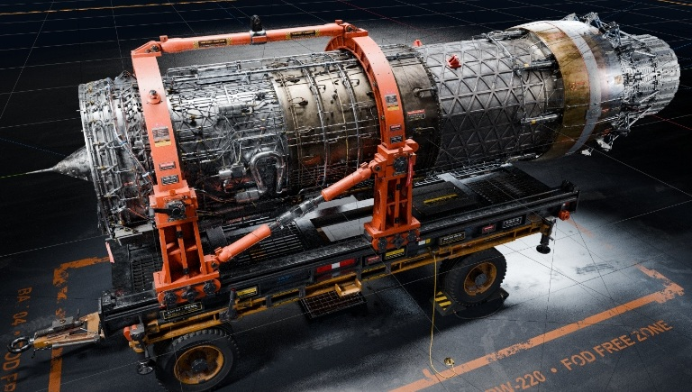
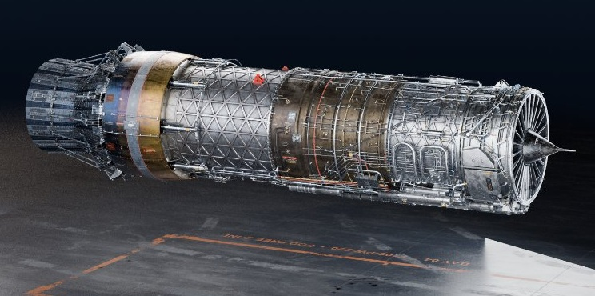
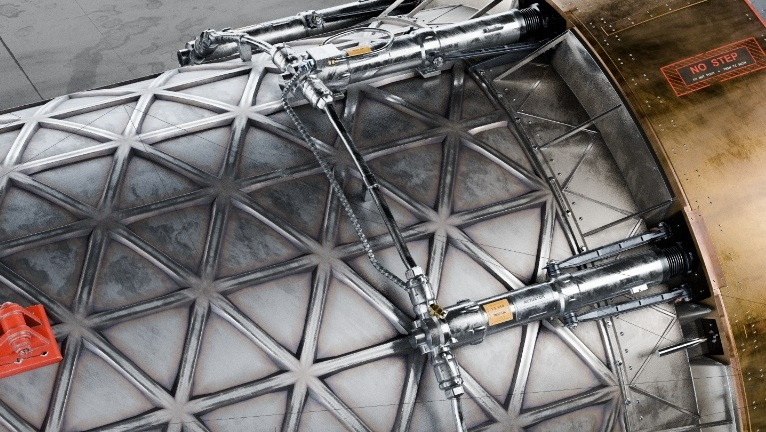
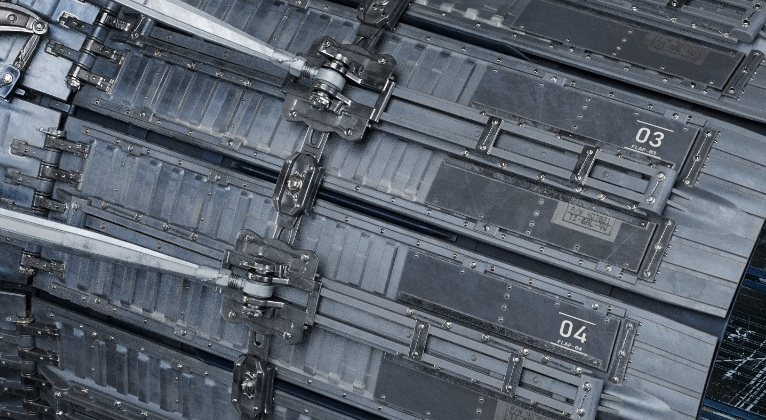

# F100-PW-220 Procedural Blender Assembly

Procedural Python build scripts and required texture assets for generating a quad-mesh Blender scene of an F100-PW-220 turbofan engine assembly, including an articulated 16-petal convergent-divergent exhaust nozzle rig, a rollover maintenance cradle, and a four-wheel steerable transport trailer.

This repository contains geometry, rigging, shading, and lighting reproduction scripts only (no volumetric exhaust or VFX simulations).



## Visual Overview



| Actuators, Plumbing & Outer Shroud | Divergent Nozzle Flaps & Linkages |
| :---: | :---: |
|  |  |

## Requirements

- **Blender 5.1+** (Cycles; GPU acceleration is auto-detected when available)
- **Python 3** with `numpy` and `Pillow` (optional; only required if regenerating the procedural decal, metal, or floor masks)

## Repository Layout

```text
.
├── build_f15_nozzle.py            # Main build entry point, kinematics self-check, and .blend export
├── f100_geom_primitives.py        # Quad-mesh modeling primitives and base clay material definitions
├── f100_engine_module.py          # Forward fan/core casing, internal sections, and articulated nozzle rig
├── f100_stand_module.py           # Maintenance rollover cradle, guide rails, and transport trailer chassis
├── f100_stand_detailing.py        # Secondary stand and chassis hardware geometry
├── f100_hardware_detailing.py     # Additional casing, shroud, and ground-support hardware geometry
├── f100_service_detailing.py      # Service caps, connectors, wire harnesses, and tag geometry
├── f100_materials_module.py       # Procedural PBR shaders, lighting presets, and embedded UI panel
├── f100_edge_and_decals.py        # Mesh curvature attribute baking and conformal decal placement
├── generate_f100_decals.py        # Optional generator for procedural decal PNGs in assets_decals/
├── generate_metal_maps.py         # Optional generator for seamless 2K metal maps in assets_masks_4k/
├── generate_floor_tiretracks.py   # Optional generator for the floor tire-track mask
├── generate_floor_baymarkings.py  # Optional generator for the floor bay-marking mask
├── assets_decals/                 # Required decal and surface weathering PNGs
├── assets_masks_4k/               # Required surface imperfection, metal, and floor masks
├── assets_hdri/                   # Required 4K environment HDRI maps
└── docs/images/                   # Viewport preview images
```

## Reproduction

Run the main build script headlessly from the repository root to construct and save `f15_exhaust_nozzle.blend` with all textures packed:

```bash
blender -b -y -P build_f15_nozzle.py
```

The build script verifies quad-only topology, `WeightedNormal` modifiers, and closed-loop nozzle linkage tolerances before saving the scene.

### Optional Maintenance Commands

```bash
# Re-apply procedural materials, decals, lighting, and UI to an existing build
blender -b f15_exhaust_nozzle.blend -y -P build_f15_nozzle.py -- --refresh-materials

# Rebuild maintenance stand geometry and refresh materials in an existing build
blender -b f15_exhaust_nozzle.blend -y -P build_f15_nozzle.py -- --refresh-stand
```

### Optional Texture Regeneration

All pre-generated procedural masks and decals are included in `assets_decals/` and `assets_masks_4k/` so `build_f15_nozzle.py` runs directly. To regenerate them locally:

```bash
python generate_f100_decals.py
python generate_metal_maps.py
python generate_floor_tiretracks.py
python generate_floor_baymarkings.py
```

## Viewport Control Panel

Open the generated `f15_exhaust_nozzle.blend` in Blender with scripts enabled (`-y` when launching from CLI) and open the 3D Viewport sidebar (`N`) under the **`F100 Nozzle`** tab:

- **Shading & Surface Condition**: Switch between `PBR`, `Component ID`, and `Clay` shading modes; adjust `Service Weathering`, `Thermal Oxidation`, `Exhaust Carbon`, `Edge Abrasion`, `Surface Erosion`, stencil visibility, condition presets (`Baseline`, `In-Service`, `Heavy Wear`), and inner seal finish (`Dark Oxide`, `Tempered`, `Base Alloy`).
- **Lighting & Environment**: Switch between `Studio`, `Workshop`, and `Inspection` presets; adjust environment rotation, background visibility, and ground plane visibility.
- **Nozzle Kinematics & Presets**: Control throat aperture (`A8`), divergent carriage offset (`A9`), or apply `Closed`, `Intermediate`, and `Full Open` presets.
- **Rotor Assembly & Actuation Cycle**: Toggle automatic rotor rotation on timeline playback, set manual rotor inspection angle, or run the 240-frame actuation test cycle.
- **Visibility & Inspection**: Toggle the outer shroud, maintenance stand, transport trailer, and internal inspection lights.

## Attribution

- **Polygon Modeling**: Carbon
- **Materials**: Neon

## Notes and Disclaimer

- This asset is a procedural visual representation intended for 3D rendering, rigging study, and visualization. Geometry, tolerances, and markings are approximate and are not derived from controlled technical data or intended for engineering analysis.
- Bundled environment HDRIs (`assets_hdri/`) and photographic surface imperfection masks (`assets_masks_4k/mask_4k_*.jpg`, `assets_decals/decal_wx_*.png`) are derived from CC0-licensed public resources.

## License

This project is released under the [Apache License 2.0](LICENSE). Bundled third-party HDRI and surface imperfection assets retain their original CC0 license.
